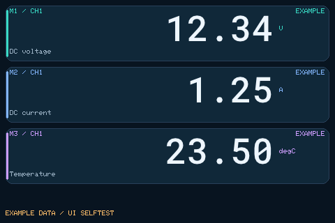
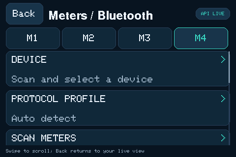
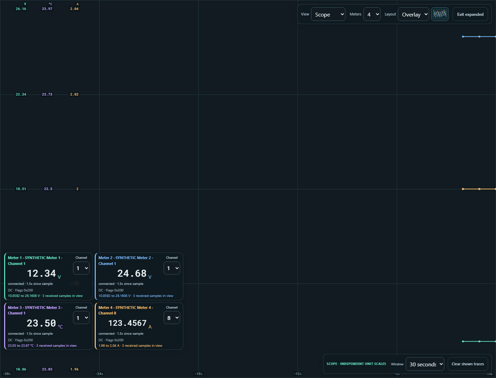

# ESP32-S3 Bluetooth Datalogger

A standalone touchscreen and local web dashboard for Bluetooth LE multimeters, including the **UNI-T UT60BT**. Read meters at the bench, compare trends, record to your browser or a supported TF card, calculate power and battery totals, and send HTTP alerts when a reading crosses a threshold.

The application is called **Meter Workbench** on the screen. It supports **1–4 independent meter slots** and [35 selectable meter profiles](docs/meter-compatibility.md). Four simultaneous physical BLE connections still need hardware validation. The Scope view plots the meter's measurement stream; it is a trend chart, not oscilloscope waveform acquisition.

**Start here:** [Download firmware](https://github.com/siujacky/Esp32-s3-Bluetooth-datalogger/releases/tag/v0.1.0) · [Setup steps](#get-started) · [User Guide](docs/USER_GUIDE.md) · [Port a board](docs/PORTING.md)

<table>
  <tr>
    <td width="50%"><br><b>Touchscreen values.</b> Actual JC framebuffer with clearly labelled EXAMPLE readings.</td>
    <td width="50%"><br><b>Explicit meter setup.</b> Actual device menu; choose a slot, device and profile, then Connect.</td>
  </tr>
</table>

## Get started

1. Download the package for your **exact board** from [release v0.1.0](https://github.com/siujacky/Esp32-s3-Bluetooth-datalogger/releases/tag/v0.1.0).
2. Extract `BOARD-v0.1.0.zip` and follow its **INSTALL.md**. The package contains the binaries and board-specific flashing instructions.
3. Power the board. On the JC3248W535, complete touch calibration if prompted: **hold → green → lift**, four corners and then the centre.
4. Enable Bluetooth on the meter. Swipe inward from the screen's left edge for **Meters / Bluetooth**. Choose M1, **Scan**, select the exact device address and correct profile, then press **Connect**.
5. Wait for **LIVE**. Swipe upward on values to change the layout or number of displayed meters.
6. For the browser dashboard, use **Functions → Network / Wi-Fi → Join device AP** to join using the displayed Wi-Fi QR. Then use **Functions → Open web → Full dashboard** to open the dashboard link, or enter the displayed HTTP address.

Continue with the illustrated [User Guide](docs/USER_GUIDE.md) for screen gestures, Wi-Fi, recording, calculations, HTTP triggers and troubleshooting. Download the [self-contained offline HTML reference](https://github.com/siujacky/Esp32-s3-Bluetooth-datalogger/releases/download/v0.1.0/README.html), or open `/readme.html` on the device.

## Choose your board

Firmware images are specific to the display, touch controller and wiring. An ESP32-S3 chip alone does not establish compatibility.

| Board / mapping | Display and touch | TF logging | PlatformIO environment |
|---|---|---|---|
| Guition **JC3248W535** | AXS15231B QSPI, 320×480 panel / 480×320 landscape; AXS15231B touch | Supported by this mapping | `ut_meter_jc3248w535` |
| Waveshare **ESP32-S3-Touch-AMOLED-1.75** | CO5300 QSPI, 466×466 round; CST92xx touch | Unsupported by this mapping | `ut_meter_amoled175` |
| **1.47-inch LCD mapping** | JD9853 SPI, 172×320; AXS5106L touch; match the [pin map](boards/meter/lcd147.json) | Unsupported by this mapping | `ut_meter_lcd147` |
| Custom mapped board | Existing supported display/touch backends with a validated board JSON | Depends on mapping | `ut_meter_mapped` |

Use the corresponding `jc3248w535-v0.1.0.zip`, `amoled175-v0.1.0.zip` or `lcd147-v0.1.0.zip` release package. A custom mapped board needs its own build. See [Porting to another board](docs/PORTING.md) and the detailed [mapping reference](docs/meter-board-mapping.md).

The supplied release builds assume **16 MB flash and 8 MB OPI PSRAM**. Confirm your board variant and package requirements before installation.

**Fresh install and upgrade are different operations.** A fresh install uses the package's full installation procedure, including bootloader/partition data. An app-only upgrade is appropriate only for an already compatible installation and preserves its partition table and NVS settings when flashed as instructed. Follow the package's INSTALL.md for the exact files, offsets and command. A standalone application `.bin` is not a complete fresh-install image. Preserve a backup before replacing existing firmware.

## What you can do

| At the touchscreen | In a phone or desktop browser |
|---|---|
| Large values, flexible 1–4 meter layouts and per-channel number formatting | Values, overlay/separate charts, expanded view and responsive phone layout |
| Saved 0° / 90° / 180° / 270° orientation and automatic dimming | Meter scan, profile selection and explicit connection controls |
| Meter setup, Wi-Fi scan/join and device status | Browser-local sessions with CSV/JSON export |
| Start/stop recording, markers and supported TF-card controls | TF status, file downloads and guarded whole-card format |
| Device HTTP triggers and native power/battery calculations | Trigger editing, browser calculations and saved summaries |



*Browser chart demonstration: synthetic readings in the current UI, not four physical radio connections.*

The dashboard is served by the ESP32 and works locally without internet. Browser logging uses **IndexedDB in that browser while the page is open**. A mounted TF card on the JC3248W535 can record autonomously after Start recording. Native and browser display preferences and calculation sessions are separate; the browser provides an explicit **Apply layout and format to device screen** action.

## Build from source

Install Python and PlatformIO, then run from the repository root:

```powershell
python -m pip install platformio
pio run -e ut_meter_jc3248w535
```

Select the environment matching your board:

```powershell
pio run -e ut_meter_amoled175
pio run -e ut_meter_lcd147
```

Build output is under `.pio/build/<environment>/`. A build does not flash hardware. For a custom mapping, follow [PORTING.md](docs/PORTING.md) before using `ut_meter_mapped`. Use the release package INSTALL.md for installation and upgrade instructions.

## Validation and limits

The edge-touch fix recognizes the JC controller's `0x63` release response and accepts deliberate inward gestures starting within a scaled 24–48 pixel edge band. The touch-corrected development application was flashed to the JC3248W535. **Physical finger confirmation of that fix is pending.** The publication release rebuild includes updated embedded help and has not been flashed. The other board targets have build verification, not current-release hardware validation.

Earlier JC hardware checks received simultaneous real UT60BT and UT202BT data, including an observation after reboot. Software fixtures exercise 1–4 slots, layouts, gaps and calculations. They do not establish four simultaneous RF links, compatibility with every profile, a complete battery discharge test or physical TF-card recording/format reliability. See the [guide's evidence notes](docs/USER_GUIDE.md#validation-and-known-limits) and [profile compatibility table](docs/meter-compatibility.md).

## Documentation and license

- [User Guide](docs/USER_GUIDE.md) — installation overview and everyday use.
- [Porting Guide](docs/PORTING.md) — add a board mapping and understand driver limits.
- [Board Mapping Reference](docs/meter-board-mapping.md) — mapping fields and validation.
- [Meter Compatibility](docs/meter-compatibility.md) — all 35 profiles and upstream status.
- [Offline HTML reference](https://github.com/siujacky/Esp32-s3-Bluetooth-datalogger/releases/download/v0.1.0/README.html) — download and open locally, or use the copy served by the device.

This project includes a GPL-3.0-or-later protocol port; retain its [license](lib/dmm_protocols/COPYING) and [attribution](lib/dmm_protocols/NOTICE) when redistributing it. Third-party components retain their own notices.
