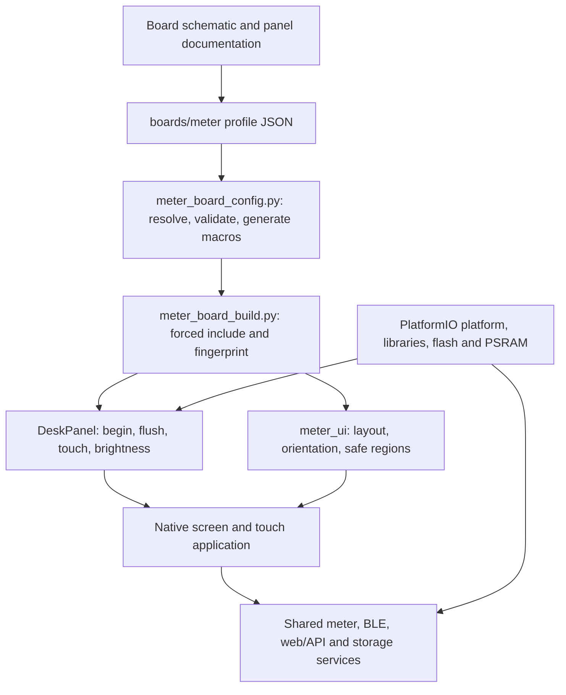

# Porting the meter firmware to another display board

This manual covers a new board profile, a new display/touch driver, and a new
build platform. Start with the [project README](../README.md) for installation
and the [user guide](USER_GUIDE.md) for normal operation. The shorter
[mapping reference](meter-board-mapping.md) describes the JSON fields.

A profile selects existing drivers and describes wiring and layout at build
time. A board with the same ESP32 generation or display-controller name is not
automatically compatible. Confirm its complete schematic, exact panel module,
touch controller, power circuitry, flash and PSRAM before choosing a porting
path. The examples below are illustrative; they are not qualification of a new
physical board.

## Architecture and the boundary of a profile



| Layer | Files | Responsibility |
| --- | --- | --- |
| Board description | `boards/meter/*.json` | Existing backend, bus pins, dimensions, offsets, touch, optional TF storage, theme and UI reference geometry. |
| Compiler | `tools/esp32/meter_board_config.py` | Inheritance, strict schema, electrical/resource checks, backend limits, resolved JSON, identity and generated header. |
| Layout validation | `tools/esp32/meter_ui_validation.py` | Check reference geometry at the actual rotated dimensions, text areas, safe circles and keyboard packing. |
| Build adapter | `tools/esp32/meter_board_build.py` | Choose a profile, validate it and force-include `.pio/build/<environment>/meter_board_config.h`. The header fingerprint participates in compiler command signatures. |
| Hardware interface | `src/esp32_touch/panel.h` and the three backend sources below | `DeskPanel` owns a native RGB565 `GFXcanvas16`, controller initialization, transfer, brightness and touch reporting. |
| Portable UI | `lib/meter_ui/src/`, `lib/ut_meter/ut_touch.*` | Resolve the same rectangles for drawing and hits, orientation, values/charts, lists, keyboards and gestures. |
| Application | `src/esp32_touch/meter/main.cpp`, `meter_touch_app.*` | Actions and state. A pin/layout-only port does not copy or fork this application. |
| Storage | `src/esp32_touch/meter/meter_storage.cpp` | Optional independent SPI3 TF worker; display bus ownership remains separate. |

### Choose the right path

1. **Is the board the exact supported model and wiring?** Use its named target
   from the table below. Verify the model/revision before uploading.
2. **Does it use the existing ESP32-S3 N16R8 platform and a supported
   display/touch pair, with a panel initialization sequence already handled by
   that backend?** Inherit the closest profile, override verified wiring and
   geometry, validate, and build `ut_meter_mapped`.
3. **Does its controller, bus protocol, power/reset sequence, pixel format,
   touch protocol or panel initialization differ?** Add or extend a hardware
   backend first. A new controller string in JSON cannot implement a driver.
4. **Does its MCU, flash size/mode, PSRAM type, partition layout or toolchain
   differ?** Add a PlatformIO platform/board configuration and audit the
   platform assumptions first. A JSON profile cannot change those settings.

The compiler accepts only the implemented pairs. It stops on an unknown pair;
it does not fall back to a visually similar board. A different panel using an
existing controller may still require a different initialization sequence, so
step 2 requires panel documentation as well as controller identification.

## Collect the electrical facts first

Fill this worksheet from the actual board schematic, module markings and vendor
panel documentation. Record URLs/document revisions in a contribution. Do not
derive pins from “ESP32-S3”, a connector photograph, another display size, or a
different board with a similar name.

| Item | Record and verify |
| --- | --- |
| Board identity | Manufacturer, full product name, PCB silkscreen revision, module marking, photographs and schematic revision. Distinguish hardware revision from a Git commit. |
| Build platform | Exact MCU, flash capacity/mode, PSRAM capacity/interface, partition requirements and existing recovery/programming path. |
| Supply and logic | Board input voltage, regulator/current budget, display/touch logic levels, I2C pull-up voltage, power-enable rails and sequencing. GPIO assignments do not provide voltage translation. |
| Display | Full controller and panel-module identity; SPI/QSPI mode, CS, SCK, data lines, DC if used, reset polarity/timing, backlight or internal brightness, native active width/height, GRAM offsets and supported clock. |
| Touch | Full controller identity, I2C address, SDA/SCL, pull-ups, reset/IRQ polarity, packet format, release behavior, native coordinate range and raw axis direction. |
| Other I2C devices | Shared-bus PMIC/address, required power setup and address collisions. The existing AMOLED PMIC check is an identity/presence check, not a general PMIC configuration driver. |
| Optional TF card | Separate SPI3 CS/MOSI/SCK/MISO, pull-ups, card supply and clock; list any display/touch/TF pin overlaps. |
| Other board wiring | USB, flash/PSRAM, boot straps, UART, LEDs, buttons and every onboard peripheral already connected to a selected GPIO. |
| Evidence and rollback | Original firmware/backup, recovery method, port used, tested board identity, firmware hash and a record of each physical check. |

The current compiler allows GPIO0–18, GPIO21 and GPIO38–48. It excludes active
native USB GPIO19/20, nonexistent GPIO22–25, and GPIO26–37 reserved for this
N16R8 platform's flash/PSRAM. It rejects duplicate active assignments across
display, touch and storage. This is a platform resource filter, not an exhaustive
electrical rule checker: boot straps, board-specific loads, voltage, polarity,
pull-ups and power sequencing still need schematic review.

`-1` means an explicitly supported unused pin. It is not a request to discover a
pin. CST92xx requires an IRQ; CO5300 uses internal brightness and requires
`display.backlight: -1`. JD9853 leaves QSPI `data1`–`data3` at `-1`; QSPI
backends leave `dc` at `-1`. Disabled storage requires all four storage pins to
be `-1`.

## Canonical hardware profiles

All three named targets currently extend the same ESP32-S3 N16R8 configuration:
`espressif32@6.12.0`, Arduino, `esp32-s3-devkitc-1`, 16 MB flash with
`default_16MB.csv`, QIO flash, OPI PSRAM and `qio_opi` memory. Native USB CDC is
enabled and NimBLE is configured for four connections/bonds. Check
[`platformio.ini`](../platformio.ini) before changing these assumptions.

| Profile / environment | Exact supported model and source boundary | Backend / touch | Native canvas; offsets | Compiled reading/setup/advanced rotations |
| --- | --- | --- | --- | --- |
| [`jc3248w535.json`](../boards/meter/jc3248w535.json) / `ut_meter_jc3248w535` | Guition JC3248W535; backend cites F1ATB demo `bd5d87ee` and Guition YAML `737d0c14`. | `axs15231b_qspi` / `axs15231b` | 320×480; 0,0 | 1 / 1 / 1: 480×320 |
| [`amoled175.json`](../boards/meter/amoled175.json) / `ut_meter_amoled175` | Waveshare ESP32-S3-Touch-AMOLED-1.75, explicitly **not 1.75C**; backend cites official `01_HelloWorld` and `10_Touch_CST9217` examples. | `co5300_qspi` / `cst92xx` (CST9217 on this board) | 466×466; 6,0 | 0 / 0 / 0: 466×466 circle |
| [`lcd147.json`](../boards/meter/lcd147.json) / `ut_meter_lcd147` | Waveshare ESP32-S3-Touch-LCD-1.47; backend cites official `03_lvgl_arduino_v8` demo downloaded 2026-10-10. | `jd9853_spi` / `axs5106l` | 172×320; 34,0 | 1 / 0 / 0: 320×172 reading, 172×320 setup/functions |
| [`lcd349_v1.json`](../boards/meter/lcd349_v1.json), [`lcd349_v2.json`](../boards/meter/lcd349_v2.json) / `ut_meter_lcd349_v1`, `ut_meter_lcd349_v2` | Waveshare ESP32-S3-Touch-LCD-3.49, exact revision; [wiring and peripherals](WAVESHARE_LCD349.md). | `axs15231b_349_qspi` / `axs15231b_349` | 172×640; 0,0 | 1 / 0 / 0: 640×172 reading, 172×640 setup/functions |

The JSON files do not record PCB revision numbers. These are exact model/source
references, not a claim that every revision of each product has identical
wiring. Confirm your board's revision against its schematic; do not substitute
1.75C or another size/revision by name alone.

| Signal | JC3248W535 | AMOLED-1.75 | LCD-1.47 |
| --- | --- | --- | --- |
| Display CS / SCK | 45 / 47 | 12 / 38 | 21 / 38 |
| Display data0 (MOSI) / data1 / data2 / data3 | 21 / 48 / 40 / 39 | 4 / 5 / 6 / 7 | 39 / -1 / -1 / -1 |
| Display DC / reset / backlight | -1 / -1 / 1 | -1 / 39 / -1 | 45 / 40 / 46 |
| Display clock | 40 MHz | 40 MHz | 40 MHz |
| Touch SDA / SCL | 4 / 8 | 15 / 14 | 42 / 41 |
| Touch I2C address / clock | `0x3B` / 400 kHz | `0x5A` / 400 kHz | `0x63` / 400 kHz |
| Touch reset / IRQ | -1 / -1; explicitly polled | 40 / 11 | 47 / 48 |
| Touch mirror X / mirror Y / swap XY | false / false / false | false / false / false | true / false / false |
| Required PMIC I2C address | none (`-1`) | `0x34` (AXP2101 presence check) | none (`-1`) |
| Storage | `sd_spi`, SPI3, 4 MHz | `none` | `none` |
| TF CS / MOSI / SCK / MISO | 10 / 11 / 12 / 13 | -1 / -1 / -1 / -1 | -1 / -1 / -1 / -1 |

**JC wiring detail:** use touch SDA4/SCL8. Do not copy nominal touch reset12 or
IRQ11 from a demo. GPIO12 is TF SCK and GPIO11 is TF MOSI on the supported
profile; the firmware leaves touch reset and IRQ disabled and polls touch.
The compiler rejects that overlap if it is introduced into a profile.

## A complete mapping-only example

Choose the closest supported profile by driver, electrical implementation and
shape. Save the following as `boards/meter/my-board.json` using UTF-8 without a
BOM. This example inherits all JC wiring, native dimensions, storage and
calibration geometry; its only overrides change UI appearance and the profile
ID. It supplies no new wiring and is **illustrative, not hardware-qualified**.
Use it on hardware only after confirming that the inherited board map matches
that exact board. For a real different board, replace hardware fields only with
values established by the electrical worksheet.

```json
{
  "extends": "jc3248w535.json",
  "id": "example-jc-ui",
  "theme": {
    "accent": 2016,
    "radius": 8
  },
  "ui": {
    "reading": {
      "profile": {"size": 1}
    }
  }
}
```

Run commands from the repository root. Install Python 3.10 or newer and
PlatformIO; host geometry runners also require `g++` on `PATH`. Compiler
validation uses the Python standard library and does not require the ESP32 SDK.

PowerShell:

```powershell
python tools/esp32/meter_board_config.py boards/meter/my-board.json .pio/map-check
$env:METER_BOARD_PROFILE = 'boards/meter/my-board.json'
try {
    pio run -e ut_meter_mapped
    if ($LASTEXITCODE -ne 0) { throw 'Mapped firmware build failed' }
} finally {
    Remove-Item Env:\METER_BOARD_PROFILE -ErrorAction SilentlyContinue
}
```

POSIX shell:

```sh
python3 tools/esp32/meter_board_config.py boards/meter/my-board.json .pio/map-check
METER_BOARD_PROFILE=boards/meter/my-board.json pio run -e ut_meter_mapped
```

The first command emits `.pio/map-check/meter_board_config.h` only after
validation. The pre-build hook validates again and generates a separate header
inside the selected environment's build directory. Edit the source JSON, never
the generated header. Rebuild after profile changes; profiles are compiled
configuration, not runtime files or physical-board auto-detection.

`pio run` defaults to `ut_meter_jc3248w535`. Always select `-e ut_meter_mapped`
for a custom profile. The named environments select their canonical JSON even
when `METER_BOARD_PROFILE` is set. A missing selection for the mapped environment
is an error. Changes to an inherited file also alter the generated-header
fingerprint and rebuild affected objects.

### Inheritance and schema rules

`extends` resolves beside the child first, then in `boards/meter`. Nested objects
merge; leaf overrides do not require copying the whole parent. The complete
resolved profile must pass schema validation. Absolute parent paths, `..`,
backslash parent paths, symlink escapes, cycles, inheritance beyond the bounded
depth of 16 files, duplicate JSON keys, unknown/misspelled keys and wrong value
types are rejected. Use `/` in relative parent paths. JSON does not allow comments
or hexadecimal numeric literals; `0x3B` in this manual is decimal `59` in JSON.

| Object | What a profile can configure |
| --- | --- |
| `schema_version`, `id` | Version `1`; a unique lowercase 1–63-character identifier using letters, digits, `_` and `-`, starting with a letter or digit. |
| `theme` | Style 0 (legacy) or 1 (workbench), RGB565 palette integers 0–65535 and radius 0–24. |
| `display` | Supported backend, native dimensions, bus pins, optional reset/backlight, clock and GRAM offsets. |
| `touch` | The supported matching driver, bus/address/clock, optional pins, supported axis transforms and optional required PMIC presence check. |
| `storage` | `none`, `sd_spi` on independent SPI3, or `sdmmc_1bit` using `clk`, `cmd`, `d0`. |
| `devices` | Optional auxiliary bus and TCA9554/PCF85063/QMI8658 fields for the 3.49 backend; see its [board guide](WAVESHARE_LCD349.md). |
| `ui.reading` | Reference canvas, baseline orientation, values, labels, flags, units and scope geometry. |
| `ui.setup` | Reference canvas, header, viewport, row/grid geometry, labels, information area and Wi-Fi QR/text. |
| `ui.advanced` | Reference canvas, rows/cards, header, keyboard and compatibility navigation rectangles. |
| `ui.overview` | Values/scope viewports, count-button rectangle/visibility, gaps and four slot colors; shares the reading reference canvas. |

The compiler accepts legacy version-1 files with explicit default theme/grid/
overview values filled into the resolved export. A new contribution should use
the current canonical profile as its reference and include any intentional
differences clearly.

### Existing controller limits

These are compiler/backend boundaries, not proof that every panel in the range
works. The display framebuffer must fit within 2 MiB; native dimensions are at
most 1024 per axis, offsets 0–255 and display clocks 1–80 MHz.

| Backend | Additional current constraint |
| --- | --- |
| `axs15231b_qspi` | Each axis at least 128; width + X offset ≤360, height + Y offset ≤640. AXS touch uses rotation/calibration; mirror/swap flags must all be false. |
| `co5300_qspi` | Each axis at least 64; width + X offset and height + Y offset ≤480. Backlight is `-1`; touch IRQ is required. |
| `jd9853_spi` | Each axis at least 64; width ≤172, height ≤320, X offset + width ≤206, Y offset + height ≤320. Only the established panel/address-window implementation is supplied. |

I2C addresses must be 7-bit usable addresses `0x08`–`0x77`; touch clocks are
10–400 kHz. A required PMIC address must differ from touch and is supported only
by the CO5300 backend. An increased JSON clock passing validation does not prove
signal integrity at that speed.

## Layout, touch and orientation

### Keep drawing and hit testing in one coordinate system

Native width/height describe the framebuffer before GFX rotation. Rotations
0/2 keep those dimensions; 1/3 swap them. Each configured view has its own
`reference_width`, `reference_height` and baseline `rotation`. Rectangles and
labels scale from that reference canvas to the actual view through
`meter_ui::Transform`. Author geometry in reference coordinates; do not insert
ad hoc physical-pixel fixes in application actions.

Rectangles use `x`, `y`, `w`, `h`; hit bounds include the left/top and exclude the
right/bottom. Labels use `x`, `y`, `size`, `align`, where align is -1/0/1 for
left/center/right and `size: 0` hides an optional label. Required fonts are
positive integer GFX sizes. Row height is distinct from row step, keeping the
gap inert. `GridLayout`, `RowLayout`, selection layouts and keyboard geometry
must be used for both the rendered shape and its hit test, including clipped
rows and the final scrolled row.

`safe_circle: true` constrains required controls to the inscribed circle minus
`safe_margin`; rectangular framebuffer corners are not usable controls on a
round panel. The chart can paint the full backing canvas while text and
interactive controls stay in the safe envelope. Test rectangular and round
layouts at their actual scaled sizes and all runtime rotations.

The current application supports **1–4 meters**, including a four-value Grid,
four separate chart panes and four overlaid traces. `ui.overview` has
`slot0_color` through `slot3_color`. A visible count button must stay outside the
mapped value/scope viewports. The Python validator retains a legacy three-lane
minimum check; that check alone does not establish readable four-meter layouts.
Run the native, value/overlay and browser tests and inspect all four counts.

Native menus and dropdowns now scroll by swipe and have **no Up/Down arrow
footer**. The version-1 `advanced.up`/`down` rectangles remain in the schema and
validator for compatibility; retaining them does not restore those controls.
Dropdown header/Cancel, every option, keyboard character pages, cursor controls,
Backspace and Done must fit and remain reachable. The short rotated LCD uses an
eight-character keyboard fallback. Check popup/list clipping and partially
visible rows after rotation; do not shrink targets to hide a geometry error.

### Raw touch to calibrated and rotated touch

The hardware adapter publishes logical coordinates for the panel's current
`getRotation()`. Do not rotate those coordinates again in application handlers.

For CST92xx and AXS5106L, `meter_ui::mapTouch()` swaps raw axes if configured,
checks the native range, mirrors native axes if configured, then applies GFX
rotation. For native dimensions W×H, normalized native x,y become:

| Rotation | Logical x,y | Logical canvas |
| --- | --- | --- |
| 0 | x,y | W×H |
| 1 | y,W−1−x | H×W |
| 2 | W−1−x,H−1−y | W×H |
| 3 | H−1−y,x | H×W |

AXS15231B uses `jc3248::decodeTouch()` and its affine calibration path. The
calibration maps **raw controller coordinates** into the compiled reading
rotation's baseline canvas. `jc3248::transformTouch()` then converts that
calibrated point from the baseline to the current runtime rotation 0–3. Saving
or selecting a different screen rotation must not refit raw calibration or
double-rotate it. Keep all three AXS mirror/swap flags false.

Runtime Screen rotation is an absolute 0/90/180/270-degree setting.
`meter_ui::orientationMap()` reflows the baseline map, and
`meter_touch::nativeMenuMap()` supplies native menu geometry. Rotation resets
gesture state and waits for finger-up; drafts and queued work survive. The
display loop owns application and NVS persistence of the requested orientation.

A correct release is as important as a correct press. A valid sample returns
`true` with `down` reflecting contact; no new sample or a malformed read returns
`false`, without inventing a release or publishing partially decoded
coordinates. The JC decoder accepts explicit release/zero-contact responses
and both captured **uniform eight-byte `0x23` and uniform eight-byte `0x63`
idle packets**. Mixed or malformed packets remain invalid. A held gesture must
end before a new edge gesture can begin.

On live values/charts, top-edge down opens Screen controls, left-edge inward
opens M1–M4 connection setup, right-edge inward opens Functions, and upward
value swipes open layout/count controls. Directions follow the visible rotated
screen. The start band is `clamp(min(width,height)/6, 24, 48)` logical pixels;
travel must be at least 48 pixels and at least twice cross-axis travel. These
shortcuts are disabled inside menus, keyboards and calibration so lists can
scroll. An initial touch on a dimmed display wakes only. Preserve this release
and gesture contract when adding a driver.

## Calibration, mapping identity and restart

The compiled map ID and SHA-256 identify the exact resolved profile, including
UI overrides. The digest uses UTF-8 JSON with sorted keys, no spaces and ASCII
escapes. Serial `status` reports map identity, native dimensions and rotations;
`GET /api/status` reports `device.mapping`, and `GET /api/board-map` downloads
the full resolved map without credentials. Use these to establish which profile
actually reached a board.

AXS calibration is separate from this complete map hash. Its NVS namespace is
derived from display configuration, touch configuration and the compiled
reading rotation. Exact canonical JC physical wiring/geometry retains
`meter-touch`; other physical maps use `mt-` plus a 12-character digest. Changing
only ID, theme or UI font/wording does not select another calibration namespace.
Changing physical display/touch settings or the calibration baseline does.

The calibration wizard captures four corners, then a center verification with
hold-until-green and lift between points. Its fixed 64-byte record has a `JCC1`
header/version, target dimensions, six binary64 affine coefficients and IEEE
CRC32 over bytes 0–59. The writer updates the inactive `cal0`/`cal1` bank, reads
back and decodes it, then verifies the active-bank selector. The prior durable
record remains available if writing/verification fails. A failed save is not a
successful calibration. On restart, a valid selected record is loaded;
missing/invalid calibration opens the wizard. The earlier single `cal` record
is accepted when no active selector exists.

Useful serial checks are `touch calibrate`, `touch calibration`, `touch status`,
`ui geometry`, and `status`. AXS calibration is enabled by the JC backend; the
other supplied touch paths use their configured normalization. A new driver
does not gain the wizard merely by defining JSON touch fields.

View count, overlay, auto-dim and runtime rotation use the separate `meter-view`
NVS namespace. Its rotation is read back before being marked saved. Test both
reported saved state and a real restart. Do not erase all NVS as a routine
porting step: it also holds user Wi-Fi, pairing and application settings.

## Adding a controller or platform

A mapping-only port needs no runtime source edits. An unsupported controller
requires a reviewed implementation at the following interfaces:

1. **Implement `DeskPanel`.** In `src/esp32_touch/panel.h`, retain the public
   `begin()`, `flush()`, `touch(uint16_t&,uint16_t&,bool&)`, `brightness(uint8_t)`,
   `diagnostic` and `touchErrors` contracts. Allocate the native RGB565 buffer
   after PSRAM initialization, detect allocation failure and report initialization
   failure. Implement documented power/reset/init, address windows, transfer
   byte order, brightness and touch release semantics for the actual module.
2. **Select exactly one implementation.** Today
   `src/esp32_touch/meter/panel_jc3248.cpp` is guarded by `UT_METER_JC3248`,
   `panel_amoled.cpp` by `UT_METER_AMOLED`, and
   `src/esp32_touch/panel.cpp` is the JD9853/AXS5106L fallback when neither is
   defined. Extend guards deliberately so an unknown/new backend cannot compile
   through that fallback or create duplicate `DeskPanel` definitions. Include
   the new source in the PlatformIO source filter if its location requires it.
3. **Extend the compiler.** Add the backend/touch pair and generated selection
   flag in `BACKENDS`, controller-specific dimensions/offsets and electrical
   constraints in `validate_profile()`, and schema/header handling only for
   genuinely new configuration. Audit calibration identity and optional-pin
   rules. Do not weaken unknown-key, pin-conflict or unsupported-pair rejection.
4. **Add portable fixtures.** Cover initialization-independent transforms,
   valid press/held/release frames, corrupt/short reads, range rejection and
   unchanged outputs on invalid input. Add profile compiler and actual map
   geometry cases, including rotations and edge releases. Controller startup
   and visible output still need hardware checks.
5. **Keep application behavior.** Use the existing shared UI, BLE/API and logging
   interfaces. A board contribution must not silently change public APIs,
   measurement decoding, saved settings or user workflows.

A new platform additionally needs a suitable `platformio.ini` environment,
board definition/toolchain, flash mode/size, partitions, PSRAM configuration,
USB setup, resource/pin filter and library compatibility audit. Check SPI host
ownership, framebuffer allocation, available RAM/PSRAM, task/interrupt behavior,
NimBLE limits and recovery. An N8 board, non-OPI PSRAM board, ESP32-C-series
board or different MCU is not converted by editing `display.width` or an ID.

Storage is optional and independent: `sd_spi` is SPI3 (`HSPI` in this Arduino
build), while the display owns its SPI2/QSPI path. The current backend does not
offer a JSON option to share the display bus or use arbitrary SPI hosts. When
disabled, its writer/download worker is compiled out. `sdmmc_1bit` is implemented
for the 3.49 board with explicit `clk`, `cmd`, `d0` and frequency fields; SPI card
pins remain `-1`. Shared display/card SPI buses are not implemented. The 3.49
backend also owns a separate auxiliary I2C bus for power controls, RTC and IMU.

## Verification in stages

Preserve original firmware, settings and card data. Build success establishes
no inference about visible pixels, voltage, touch, reboot persistence or RF
links. Record each stage separately with board revision, profile hash, firmware
hash, commands, results and untested items.

### 1. Compiler and host evidence

From the repository root, these checks do not access hardware:

```sh
python tools/esp32/test_meter_board_config.py
python tools/esp32/test_meter_ui_validation.py
python test/test_meter_ui/run_mapped_tests.py
python test/test_meter_overlay/run_mapped_tests.py
python test/test_meter_orientation/run_host.py
python test/test_meter_native_swipe/run_host.py
pio test -e native
```

Use `python3` instead of `python` where that is your Python command. The host
runners use `g++`; `pio test -e native` uses the host platform, not an ESP32.
The mapped runners exercise canonical top-level profiles; a temporary inherited
example is not automatically added. Validate your custom file explicitly, build
it with `ut_meter_mapped`, and add resolved-layout cases to the portable tests
for a contributed custom layout.

Checks cover real compiler rejection paths, shared geometry, exact hits, inert
gaps, final scrolled rows, round safe areas, keyboard/dropdown reachability and
all runtime orientations. The synthetic 800×480 geometry fixture proves layout
scaling only. It does **not** prove an 800×480 controller, panel or framebuffer
transfer works. The Python overview check's legacy three-lane minimum likewise
does not substitute for the four-meter geometry tests or physical readability.

### 2. Firmware build evidence

Build your mapped profile as above. For a driver/platform change, also build the
existing regression targets:

```sh
pio run -e ut_meter_jc3248w535 -e ut_meter_amoled175 -e ut_meter_lcd147
```

These commands compile firmware and do not upload it. Retain the selected JSON,
resolved map/header, environment, firmware binary hash and build log. Confirm
that your selected map, controller flag and flash/PSRAM configuration agree.

### 3. First power-on and visible screen

Confirm the connected board identity and recovery path before an intentional
upload. Use the matching build and confirmed programming port; see the
[user guide](USER_GUIDE.md) for upload instructions. Check supply/current,
startup diagnostics and framebuffer allocation. Inspect the actual display for
complete address windows, RGB order, offsets, orientation, brightness, clipping
and all corners. A framebuffer capture proves rendered content, not that the
physical panel shows it.

### 4. Physical touch, release and restart

On the real screen, press the center and near each edge/corner. Verify each
touch lands on the same visible control, held contacts remain held, finger-up
releases, and a new gesture can start immediately. Exercise top/left/right edge
shortcuts and repeated swipe/lift cycles in all four runtime rotations. Verify
ordinary list scrolling, inert gaps, dropdown Cancel/outside taps, the last
choice/row, every keyboard page/control, and wake-only first touch. Check that
calibration/menu interactions do not open live-screen edge shortcuts.

For AXS, complete four-corner/center calibration, confirm saved/readback/CRC
diagnostics, restart and verify that the saved mapping loads and physical hits
remain correct. Test rotation save/restart independently. Preserve existing NVS;
UI-only profile changes should keep compatible calibration. Never report a
serially injected gesture as proof of physical finger accuracy.

### 5. BLE, Wi-Fi and optional TF coexistence

Connect the real meters available, confirm fresh raw measurements, channel/unit
mapping and reconnect after restart while using Wi-Fi and the browser. Check
counts 1–4 and overlay/separate/Grid layouts with clearly labeled fixtures when
real meters are unavailable. Fixtures establish UI behavior only; qualification
of four simultaneous links requires four real meters streaming together.

For TF-enabled boards, back up the card or use a dedicated test card. Verify
mount/read/list, record a short **new** session, stop/flush it, download it, and
check content/byte count while display/touch, BLE and Wi-Fi remain active.
Confirm earlier files remain readable and unchanged. Include restart/remount
and read/write error handling. Do not format or delete existing data as a port
test; formatting is a separate destructive user action.

The current publication has physical JC3248W535 display/touch evidence and
earlier real UT60BT + UT202BT simultaneous streaming/restart evidence. The other
two display targets have source/build/portable geometry coverage, which is not
physical display qualification. The current release has no fresh physical meter
frames establishing a new RF test, and four simultaneous real BLE links remain
pending. New-board electrical, visible-panel and touch behavior require their
own evidence.

## Port acceptance and contribution

- [ ] Record exact board/PCB revision, panel/touch identities, schematic/source
      revisions, electrical worksheet and recovery method.
- [ ] Select the correct path: profile-only, controller/backend, or platform.
- [ ] Validate the resolved profile and review every pin/resource assignment;
      retain independent storage ownership and platform flash/PSRAM settings.
- [ ] Run applicable compiler, native and mapped geometry checks; inspect all
      rotations, counts 1–4, round/rectangular safe areas, popups and keyboards.
- [ ] Build the mapped firmware and all affected canonical targets; record hashes.
- [ ] Verify the actual visible panel and physical press/held/release/edge hits.
- [ ] Verify calibration CRC/readback and rotation/settings persistence after a
      real restart without erasing unrelated NVS.
- [ ] Verify real BLE + Wi-Fi behavior, stating actual meter count/models and
      duration; separately label example readings and pending four-link RF work.
- [ ] If TF is present, verify new-session write/flush/read/download and preserve
      existing files; otherwise confirm storage reports unsupported.
- [ ] Separate static/build, controller, screen-capture and physical evidence;
      list failures and untested stages instead of declaring general support.

Submit a profile under `boards/meter` with a unique descriptive ID, the smallest
useful inheritance override, documentation of the exact board revision and
source evidence, tests/results and any physical limitations. Include driver or
platform changes only when required and keep them reviewable separately from
the profile. Update this manual's supported-profile table and the
[mapping reference](meter-board-mapping.md), and link user-facing instructions
from the [README](../README.md) and [user guide](USER_GUIDE.md). A contribution
is hardware-qualified only to the extent its recorded physical checks show.
