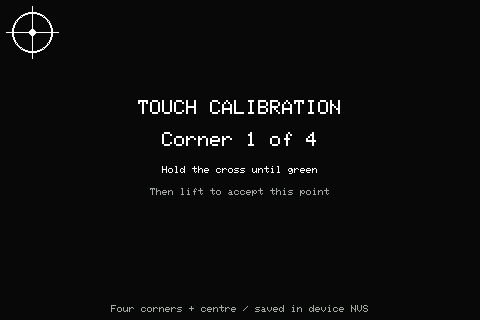
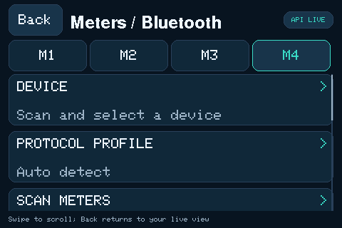
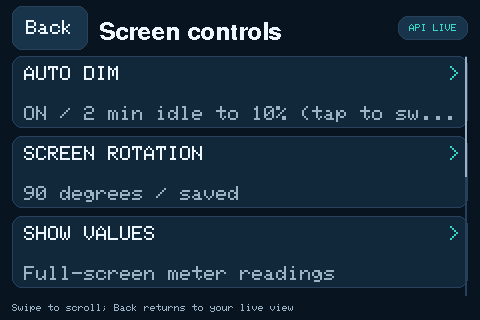
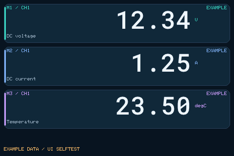
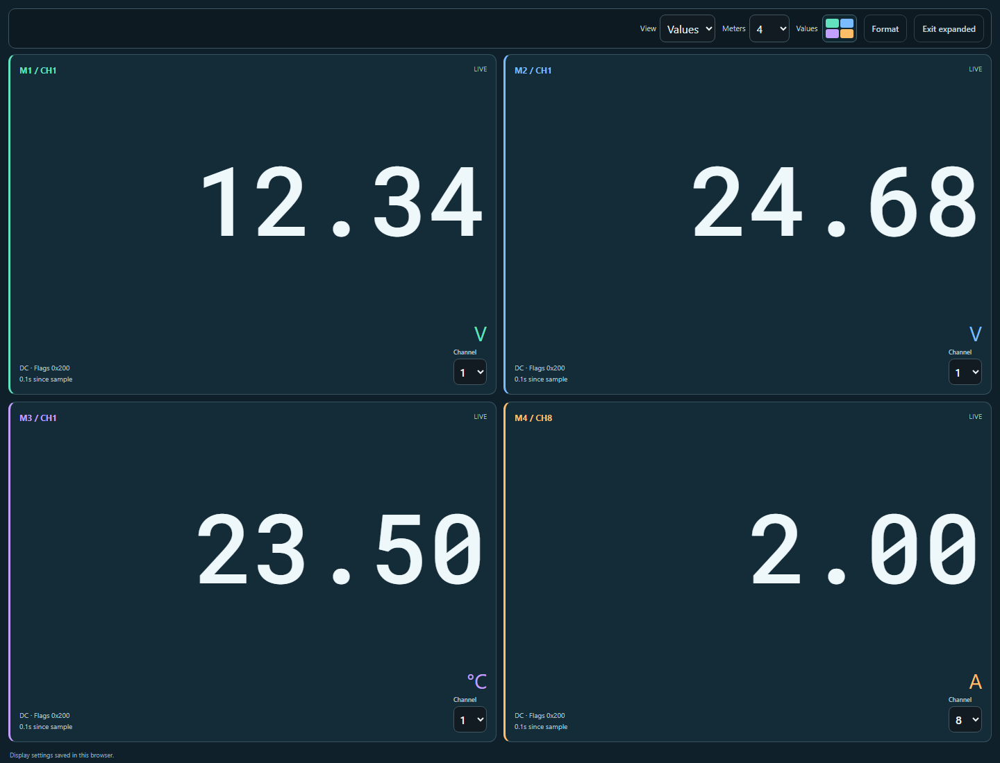
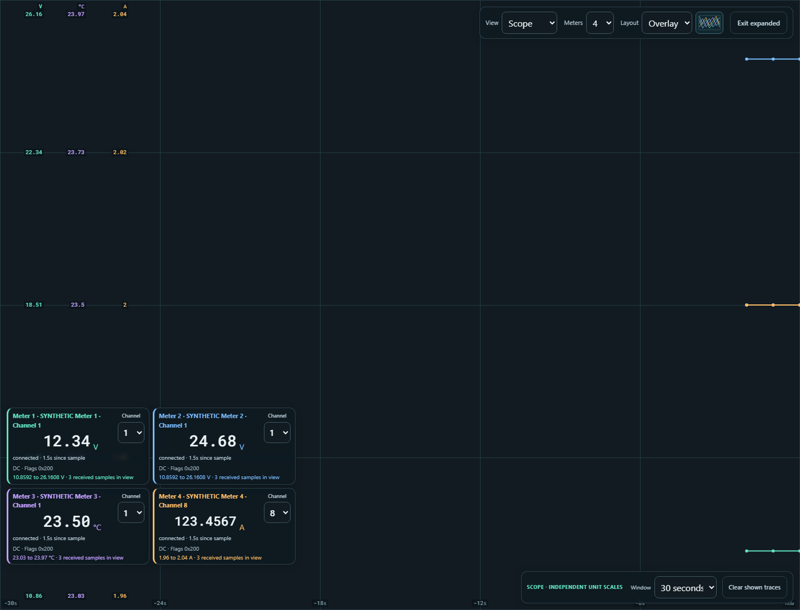
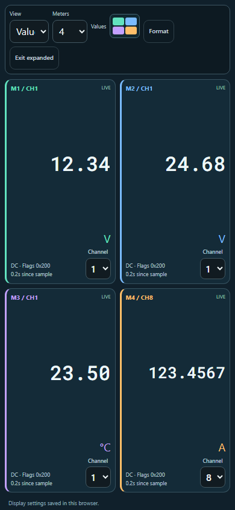
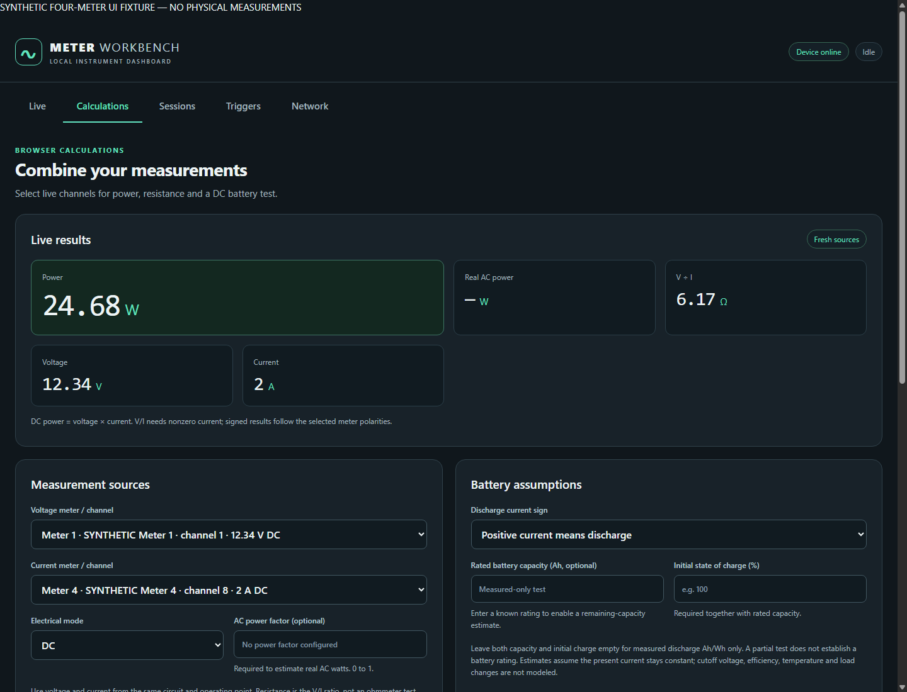

# Meter Workbench User Guide

Use an ESP32-S3 touchscreen as a standalone Bluetooth LE multimeter display and datalogger, with a local dashboard for your phone or computer. This guide covers the firmware in [release v0.1.0](https://github.com/siujacky/Esp32-s3-Bluetooth-datalogger/releases/tag/v0.1.0).

[First reading](#your-first-reading) · [Touch controls](#touch-controls) · [Wi-Fi and browser](#wi-fi-and-the-browser-dashboard) · [Recording](#recording-and-downloads) · [Calculations](#power-and-battery-calculations) · [HTTP triggers](#http-triggers) · [Troubleshooting](#troubleshooting)

## Install the matching firmware

Choose the exact board in the [board table](../README.md#choose-your-board), then download its `BOARD-v0.1.0.zip` package from the [release page](https://github.com/siujacky/Esp32-s3-Bluetooth-datalogger/releases/tag/v0.1.0). Extract the ZIP and read **INSTALL.md** before flashing. It includes the required binaries, offsets and commands for that board.

Use the full installation procedure for a fresh board. Use an app-only upgrade only when the existing installation has a compatible partition layout; that procedure preserves the partition table and NVS containing device settings. Do not treat an application `.bin` as a complete fresh-install image. Keep a backup of existing firmware and settings before replacement.

To build instead, install PlatformIO with `python -m pip install platformio` and run `pio run -e ut_meter_jc3248w535`, `pio run -e ut_meter_amoled175` or `pio run -e ut_meter_lcd147` for the matching board. See [PORTING.md](PORTING.md) for custom mappings and `ut_meter_mapped`.

## Your first reading

### 1. Calibrate touch when prompted

On the JC3248W535, an absent or invalid saved calibration opens the wizard automatically.

1. Keep the board in the landscape orientation shown by the wizard.
2. Hold the displayed corner cross steadily until it turns green, then lift completely.
3. Repeat for all four corners.
4. Hold and lift on the centre target to verify the mapping.
5. Wait for **CALIBRATION SAVED**, which confirms a checked NVS write/readback.



*Actual device framebuffer. Follow the active target shown on your board; the screenshot is not a physical finger-accuracy test.*

Calibration is saved inside the ESP32 and needs no TF card. A valid mapping skips the wizard at the next boot. To repeat it, open **Functions → Diagnostics → Touch calibration**, or use **Network → Calibrate device touchscreen** in the browser. Rotation changes wait until calibration is finished. Three failed centre checks restart the corner sequence.

### 2. Scan, select, then connect

1. Turn on the meter and enable its Bluetooth function.
2. Close a phone or PC application already connected to that meter.
3. From live values or the chart, swipe inward from the **left edge** to open **Meters / Bluetooth**.
4. Select **M1**. Press **Scan meters** and wait for discovery to finish.
5. Open **Device** and choose the exact name/address. Choose the correct **Protocol profile** while disconnected. Generic `BDM`, `Bluetooth DMM` or UT-D07 adapter names need explicit model selection.
6. Press **Connect**. Selecting a discovered device or a meter tab does not start a connection.
7. Return to values and wait for **LIVE**, which means a recent valid reading has arrived.



*Actual device menu. M1–M4 select independent setup slots.*

Repeat in M2–M4 for additional physical meters. A physical address cannot occupy two slots. Saved assignments can reconnect automatically; **Disconnect** explicitly stops retries for that slot. Rescan if the meter changes its BLE address. All [35 registered profiles](meter-compatibility.md) are selectable, with model-specific verification limits.

**CONNECTED** indicates a BLE link. **LIVE** requires a valid packet received within three seconds; older readings become **STALE**. Prolonged silence causes a reconnect attempt. A stale or non-numeric reading is not a new measurement.

## Touch controls

These shortcuts apply on the live value and Scope screens. Start near the edge and make a deliberate inward swipe, then lift.

| Gesture / action | Result |
|---|---|
| Top edge → down | **Screen controls**: Auto dim, Screen rotation, Show values and Show full scope |
| Left edge → inward | **Meters / Bluetooth**, with M1–M4 setup tabs |
| Right edge → inward | **Functions**, including Wi-Fi, recording, TF files, triggers, calculations and diagnostics |
| Swipe up on values | **Value controls**: layout, meter count, rotation, number format and links to other menus |
| Tap the Scope graph | Return to values |
| Swipe up/down inside a menu | Scroll its controls; there are no footer Up/Down arrow buttons |
| Back | Return to the previous page or live view |



*Actual Screen controls menu, opened by a top-edge downward swipe.*

The gesture detector uses a scaled **24–48 pixel start band** and requires at least **48 pixels** of inward travel with the inward motion dominant. Swipes in menus, forms and keyboards keep their scrolling/editing behavior. Physical finger confirmation of the latest edge fix is still pending.

### Orientation and dimming

Choose **Screen rotation** in Screen controls or Value controls: **0°, 90°, 180° or 270°**. Values, charts, menus, keyboard and QR pages reflow together. The selected rotation is saved across restart; check the displayed saved state if a save fails. On the JC panel, portrait is 320×480 and landscape is 480×320. The browser's **Network → Device screen → Orientation** control changes the device screen.

**Auto dim** defaults on. After two minutes without touch, brightness falls from 55% to 10%. The **first touch while dimmed only wakes the display**; lift and touch again to use a control. Calibration stays bright. BLE, Wi-Fi, calculations and recording continue while dimmed. Battery runtime savings have not been measured.

### Values, layouts and number format

Swipe up on values and choose **Meters shown** for 1, 2, 3 or 4 slots. The main/focused meter comes first; subsequent slots follow in order and wrap after M4. Layouts include Solo, Equal rows, one large value with smaller companions, and the four-meter grid, as available for that count.



*Actual JC software framebuffer with EXAMPLE data. This demonstrates rendering, not three simultaneous physical measurements.*

Open **Values / Format** to select a meter/channel, total digits, decimal places and leading spaces or zeros. Total digits range from **3–8**; decimals range from **0–6** and must be fewer than total digits. Sign and decimal point have separate space. Preview changes, then press **Save number format** and check saved status.

Formatting changes presentation only. Charts, API responses, calculations and logs retain original precision. A value that cannot fit shows **OVR** with the original reading available; overload and other invalid values remain distinct from zero.

### Scope is a trend chart

Use **Screen controls → Show full scope**, or **Functions → Scope controls → Show full scope**. Choose Overlay for a shared chart or Separate for lanes. Matching units share a numeric scale; mixed units have labelled independent ranges and a common time axis. Each meter/channel retains its own history.

The native chart keeps the latest 128 observations per channel, with selectable windows of 5, 10, 30, 60, 120 or 300 seconds. A longer window does not create samples. Unit, mode, profile or source changes reset the affected trace; invalid readings and long gaps break the line. This is the meter's actual measurement stream, not oscilloscope waveform capture.

## Wi-Fi and the browser dashboard

### Join the device access point

Open **Functions → Network / Wi-Fi → Join device AP** to display the Wi-Fi QR. Scan it to join the network. Then open **Functions → Open web → Full dashboard** and scan that link QR to open the dashboard, or enter the device's displayed HTTP address. The Web / WiFi screen also shows AP credentials for manual joining: use the **SSID and password shown by your board**. The Wi-Fi QR joins the network; the dashboard QR opens a page.

Stay connected when a phone reports that the device AP has no internet. The dashboard and offline manual are served by the ESP32; their assets need no internet connection. The browser Network tab supplies a larger QR and the device's addresses. Treat the AP QR as a credential and avoid sharing screenshots of it publicly.

### Join an existing Wi-Fi network

In the browser's **Network** tab, choose **Scan Wi-Fi**, select a nearby 2.4 GHz network, enter its password and explicitly press **Join network**. On the touchscreen use **Functions → Network / Wi-Fi → Scan networks**, select the SSID, enter its password, then **Join network**.

An open network needs a blank password. Hidden networks can use manual SSID entry. WEP, WPA-only and Enterprise networks are not offered as simple password-only joins. Check the reported connection state and assigned station address; a saved request is not proof of a successful join. The device AP stays available. **Disable LAN** on the touchscreen forgets station credentials and keeps the AP running.

Reach external HTTP services or internet NTP servers through a network the ESP32 can access. From another device on the same LAN, use the station address displayed by Meter Workbench.

### Use the browser instrument

**Live** contains M1–M4 setup, Values/Scope, Meters, Layout, Channel, Format and Expand. Scan, select a device/profile and press Connect explicitly, just as on the native screen. **View** on a meter card selects the first displayed slot. **Expand** fills the instrument area and requests browser fullscreen where supported.



*Browser fixture demonstration: four example meter values.*



*Browser fixture demonstration: Overlay view with four example streams.*



*Phone viewport demonstration. Display and chart controls remain available on small screens.*

Native view settings are saved on the ESP32. Browser view, channel and format preferences are saved locally in that browser and can differ. **Save in browser** changes browser formatting; **Apply layout and format to device screen** explicitly sends those settings to the touchscreen. Native and browser chart histories and Clear actions are also independent.

## Recording and downloads

Choose your recording destination deliberately:

| Destination | Collection | Where data lives | Export |
|---|---|---|---|
| Browser sessions | Dashboard must remain open and collecting | IndexedDB for that browser/profile and dashboard address | **Sessions → CSV / JSON** |
| TF card, supported JC mapping | Device continues after the browser closes, while recording and storage are working | Files on the mounted card | **Sessions → TF card → Download CSV**; native file menu offers a download QR |
| Device RAM feed | Short reconnect backlog only; bounded and volatile | ESP32 RAM | Feeds the dashboard; not durable storage |

### Record a session

1. For TF recording, insert a compatible FAT card and check **Sessions → TF card** or **Functions → TF card / files**. It must report mounted. **Remount TF / Retry mount** retries without formatting.
2. Enter an optional label, then press **Start recording** in Live or native Recording.
3. Add markers to tag events. Browser and TF destinations use the device session identity and sequence numbers.
4. Monitor checked-written, pending/dropped counts and errors. A recording flag alone does not prove a card write succeeded.
5. Press **Stop** and wait for pending TF writes to finish before removing the card or power.
6. In Sessions, export the browser session or refresh the TF file list and download the card CSV.

Browser recordings belong to the browser/profile **and URL** used to open the dashboard. An AP address and a LAN address can have different browser storage. Export before clearing site data. JSON exports include session and gap metadata; CSV contains readings and events.

TF files use `/meter-logs/meter-<boot-id>-<session-counter>.csv` and are not overwritten by later sessions. Active-file downloads take a fixed-length snapshot; recording can add later samples afterward. CSV downloads are routed to a separate local HTTP server on port **81**, so that port must also be reachable. The other supplied board mappings report TF storage unsupported and keep browser logging available.

The RAM backlog is bounded (2048 records with PSRAM, 256 fallback). Long outages, closed tabs, write failures and power loss can leave gaps or an unfinished recording tail. Gaps are reported rather than filled with invented values. A successful software flush/sync does not eliminate power-loss risk.

### Format only when you intend to erase the card

Normal mounting never formats a card. **Format TF card** erases **every file on the TF card**. Stop recording, wait for pending writes/downloads, choose Format, type **FORMAT TF CARD**, and confirm. Watch the matching operation's final result; an accepted or queued request is not proof that formatting succeeded. Cancel leaves the card unchanged. This operation does not format ESP32 internal flash.

## Power and battery calculations

Use **Functions → Power / battery** for native calculations or the browser's **Calculations** tab. Choose voltage and current sources by meter/channel, then set the electrical assumptions before starting a test.



*Calculation fixture demonstration, not a physical battery discharge test.*

| Mode / result | Meaning |
|---|---|
| DC power | Voltage × current, in watts |
| AC / RMS | Voltage × current is apparent power in **VA**. Real watts require an entered power factor; blank PF leaves real watts unknown. |
| V/I | Ratio of the selected voltage and current; it is not an ohmmeter measurement |
| DC battery integration | Separate charge/discharge Ah and Wh over observed valid intervals; choose the discharge-current sign correctly |
| SOC / runtime | Estimates using entered capacity, initial SOC and observed charge/current; not a measured battery rating |

Sources should describe the same circuit. Separate meters are not synchronized. Both sources must be fresh and compatible; invalid values, unsupported flags, sample skew and gaps pause or exclude integration. Do not continue an SOC claim across an unobserved interval: reset and establish suitable starting assumptions. Estimates omit cutoff, efficiency, temperature and changing load.

Native totals/settings remain in **device RAM** and continue while another native page is open. Reset/reboot loses them. Browser calculations, settings and saved summaries belong to that browser and are independent; save/export them in the browser. Changing sources or assumptions requires the appropriate pause/reset before continuing a sampled test. A full physical discharge cycle has not been validated.

## HTTP triggers

Create device rules in **Functions → Triggers / HTTP** or browser **Triggers → New trigger**. Choose an exact meter, channel and displayed unit, an **Above** or **Below** threshold, hysteresis, cooldown, target URL and **GET** or **POST**. Up to eight rules are supported. Rules run on the ESP32 while the browser is closed; the target must be reachable from the ESP32.

For **Above 12 V, hysteresis 0.2 V**, a reading must be strictly greater than 12 V to fire. The rule re-arms at 11.8 V or below. Below rules work in the opposite direction. A crossing during cooldown is consumed: the value must leave the hysteresis region and cross again after cooldown. Remaining above the threshold does not produce periodic requests. Only matching numeric readings in the exact configured unit qualify.

### API examples

Send JSON to `POST /api/rules` at the device's displayed base address, with `Content-Type: application/json`. API meter/channel indexes start at **0**; UI labels start at 1. Omit `id` to create a rule. These example destinations are placeholders to replace with your own reachable service.

GET rule for meter 1, channel 1:

```json
{
  "enabled": true,
  "meter": 0,
  "channel": 0,
  "unit": "V",
  "operator": "above",
  "threshold": 12,
  "hysteresis": 0.2,
  "cooldownMs": 10000,
  "url": "http://192.168.1.50/alert",
  "method": "GET"
}
```

GET appends URL-encoded `value`, `unit`, `meter` and `timestamp` query parameters. `meter` is zero based; `timestamp` is Unix milliseconds when the clock is set, or empty otherwise.

POST with a JSON body template:

```json
{
  "enabled": true,
  "meter": 0,
  "channel": 0,
  "unit": "V",
  "operator": "above",
  "threshold": 12,
  "hysteresis": 0.2,
  "cooldownMs": 10000,
  "url": "http://192.168.1.50/alert",
  "method": "POST",
  "headers": {"Content-Type": "application/json"},
  "body": "{\"value\":{{value}},\"unit\":\"{{unit}}\",\"meter\":{{meter}}}"
}
```

Body and header-value templates support `{{value}}`, `{{unit}}`, `{{meter}}` and `{{timestamp}}`. With an empty POST body, the firmware produces JSON containing `value`, `unit`, zero-based `meter`, nullable `timestamp` and `manualTest`. `cooldownMs` accepts 0–86400000. URLs must use HTTP or HTTPS without embedded credentials or fragments; header values must be strings.

Read `GET /api/rules` for saved configuration and delivery results. `POST /api/rules/test` with `{"id":1}` sends a real test request for that saved rule, using a matching recent numeric reading. Use the returned rule ID rather than assuming it is 1. A queued test is not confirmed delivery.

HTTPS verifies server certificates using the build's CA bundle or the optional `caPem` PEM certificate and requires a synchronized clock. Requests have bounded queues/timeouts and do not follow redirects or automatically retry. Inspect the last HTTP code/result and device events. An HTTP 2xx response is the delivery criterion; response bodies are not retained.

The local API has same-origin browser checks and no account login. Use it on a trusted local network. The complete offline reference at `/readme.html` also describes status, control, frames, recording, storage and Wi-Fi endpoints. A [downloadable HTML copy](https://github.com/siujacky/Esp32-s3-Bluetooth-datalogger/releases/download/v0.1.0/README.html) is included with the release.

## Date, time and NTP

Open **Functions → Date / Time / NTP** or browser **Network → Date / time**. Choose automatic NTP, a preset server or custom hostname/IPv4 address, press **Save settings**, check saved status, then **Sync NTP now**. Enter a hostname/address without `http://` or a port.

NTP stores **UTC**. Internet servers need working station Wi-Fi; a reachable numeric local NTP server can work on the device AP subnet. Browser clock synchronization remains a fallback. Check the reported clock source and successful sync time; accepting a request does not prove an NTP response. Logs retain uptime when UTC is unavailable. HTTPS needs a valid synchronized device clock.

## Troubleshooting

| Symptom | Check |
|---|---|
| No meter discovered | Enable BLE, close competing meter apps, scan again and check the exact address. A generic adapter name needs the correct explicit profile. |
| Connected but STALE | Verify the profile and wait for valid packets. Link state alone does not prove live readings. Disconnect stops retries; Connect starts them again. |
| Edge swipe does not open a menu | Begin within the edge area, swipe deliberately inward for at least 48 pixels, then lift. Wake a dimmed screen first. The latest physical edge fix still needs finger confirmation. |
| Touch position is wrong | Reopen Touch calibration in Diagnostics or browser Network. Hold until green and lift between targets. |
| A setting reverts after restart | Check its saved/readback state. Browser preferences are separate from native device settings. |
| Dashboard will not open | Stay on the device AP despite “no internet”, and use the displayed HTTP address. From a LAN use its station address. |
| QR will not scan | Keep the white border visible and reduce glare. Join manually with displayed credentials or use the browser's larger QR. |
| Wi-Fi join fails | Check 2.4 GHz network/security support and password, then explicitly Join. Disable LAN and retry if saved credentials are wrong. |
| Browser recording is missing | Use the same browser/profile and dashboard URL. Check IndexedDB status and export before clearing site data. Collection needs an open page. |
| TF recording/download fails | Check supported/mounted state, errors, written/pending/dropped counters and port 81 reachability. Stop and wait before removing media. Remount does not format. |
| Trigger does not fire | Check slot/channel, exact unit, strict crossing, hysteresis re-arm and cooldown. Confirm destination reachability; for HTTPS check clock and CA trust. |
| Power, SOC or runtime is unavailable | Check fresh voltage/current sources, DC/AC mode, sign, PF and capacity/SOC assumptions. Gaps can invalidate continuity. |
| Board remains in bootloader after upload | Release BOOT and tap RESET. Verify the board/USB identity and follow the package INSTALL.md. Close serial monitors before uploading. |

For USB Serial/JTAG diagnostics the monitor speed is 115200. A Python serial client should set `rts=False` and `dtr=True` before opening; asserted RTS can hold this device in reset. USB application and bootloader COM ports can differ.

## Validation and known limits

The release source includes the JC touch release fix (`0x63`) and the scaled 24–48 pixel edge start band. The touch-corrected development application was flashed to the **JC3248W535 only**. Physical finger confirmation of edge navigation is pending. The publication release was rebuilt with updated embedded help and has not been flashed. Other supplied board targets have build verification, not current-release hardware testing.

Earlier JC firmware checks received simultaneous real UT60BT and UT202BT readings. A roughly 60-second observation after reboot reported both streams connected/fresh with advancing packet counters and simulation disabled. This is earlier hardware evidence, separate from the publication rebuild. Software fixtures cover 1–4 meter layouts, mixed units, gaps, storage workflows and calculations. Four simultaneous physical BLE links, every selectable profile, a full battery discharge cycle and physical card recording/download/format reliability remain separate validation work. The current JC card mounting successfully does not establish those storage operations.

Screenshots labelled EXAMPLE or fixture demonstration show rendering and UI behavior. Actual device menu/framebuffer captures demonstrate the software screen content; they do not establish physical panel visibility, finger accuracy or phone-camera QR scanning. See [Meter Compatibility](meter-compatibility.md) for all 35 profiles and upstream decoder status, and [PORTING.md](PORTING.md) for board support boundaries.
